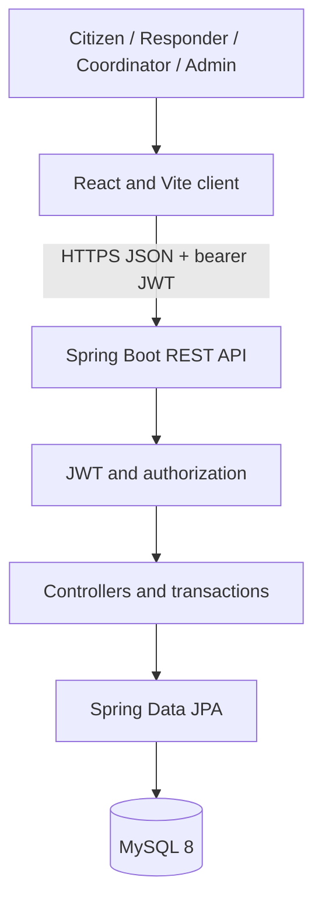
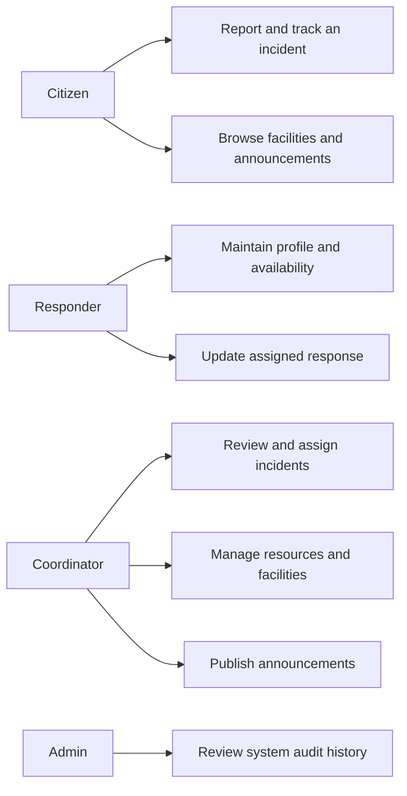
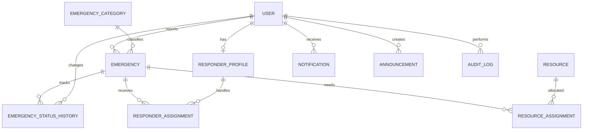
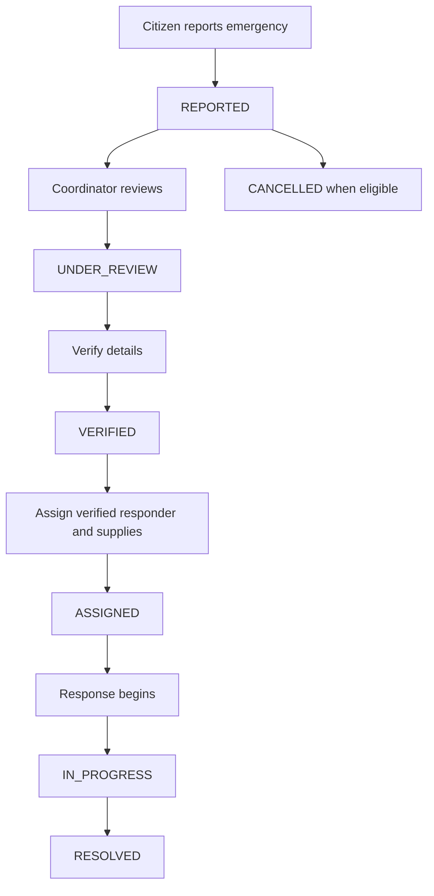

# Local Emergency Resource Coordination System

## 1. Abstract

The Local Emergency Resource Coordination System (LERCS) is a web application that helps a community organize emergency reports and local response information. Citizens submit reports and follow their progress. Coordinators review incidents, assign verified responders, and allocate available supplies. The application also maintains shelter and hospital information, announcements, notifications, and an audit history. It is designed as an information coordination aid and does not replace official emergency services.

## 2. Introduction

Emergencies create many simultaneous requests for information and assistance. A shared system can help a local team see reports, available resources, and response progress in one place. LERCS provides a web interface for residents, responders, coordinators, and administrators, backed by a relational database and a secured REST API.

## 3. Problem Statement

Local emergency information may be scattered among phone calls, messages, spreadsheets, and separate facility lists. This makes it difficult to track request status, avoid duplicate effort, identify available supplies, and preserve a record of decisions. LERCS centralizes these records and provides role aware access.

## 4. Existing System

In a manual process, residents contact different organizations, staff keep separate records, and resource availability can become outdated. Updates may not reach the people who need them. These limitations motivate a single, searchable coordination workspace.

## 5. Proposed System

LERCS gives residents a form to report incidents and check status. Coordinators use a dashboard to review incidents, assign responders and supplies, and publish community updates. Verified responders maintain availability and update their assigned work. Facility managers can keep shelter capacity and hospital availability current.

## 6. Objectives

- Record emergency requests with location, priority, category, and assistance needs.
- Make incident status and assignment history visible to authorized users.
- Track responder availability and local supply quantities.
- Publish shelter, hospital, and announcement information.
- Protect accounts and personal information with authentication and role checks.
- Provide a maintainable, documented foundation suitable for a student demonstration.

## 7. Scope

The application covers account registration, incident coordination, responder profiles and assignments, supply tracking, facilities, announcements, internal notifications, audit records, and interactive OpenStreetMap views for locations with coordinates. The initial project uses community supplied information. It does not provide a dispatch guarantee, emergency-service integration, or SMS/email delivery.

## 8. Functional Requirements

1. Citizens can register, sign in, create emergency reports, view their own requests, and view public facilities and active announcements.
2. Coordinators can review incident records, adjust status, assign responders and resources, manage facilities, and publish announcements.
3. Responders can maintain a profile and availability, view assignments, and update their response status.
4. Administrators can access coordination functions and review audit activity.
5. The system records emergency status transitions and important operational actions.
6. The system prevents negative stock and capacity values above their configured limits.
7. List endpoints support pagination; the client provides search for common lists.

## 9. Non-Functional Requirements

- Security: BCrypt password storage, JWT authentication, least privilege role checks, input validation, and configurable secrets.
- Reliability: relational persistence, transaction boundaries around stock/assignment updates, and consistent error responses.
- Usability: responsive pages, explicit status labels, accessible form labels, and clear loading/error/empty states.
- Maintainability: layered Spring architecture, request DTO validation, React component separation, and documented configuration.
- Performance: pagination and database indexes on common incident, resource, notification, and audit queries.

## 10. User Roles

| Role | Responsibilities |
|---|---|
| Citizen | Register, report and track own incidents, view community facilities and updates |
| Responder | Maintain skills and availability, view assigned incidents, update response progress |
| Coordinator | Review incidents, assign responders/resources, update local facility information |
| Admin | Coordinate system-wide operations and view audit history |

## 11. System Architecture

The React single-page client sends JSON requests to Spring Boot REST controllers. Spring Security checks a signed JWT and role-sensitive business operations. Spring Data JPA maps entities to MySQL tables. Development can use H2 without a separate database installation.

## 12. Use Cases

- Citizen: create account, sign in, submit report, track status, view shelters, hospitals, and announcements.
- Responder: submit profile and skills, set availability, review assignments, accept or update response work.
- Coordinator: inspect reports, verify and progress incidents, assign a verified available responder, allocate supplies, maintain facility data, and publish announcements.
- Admin: access coordination capabilities and inspect audit events.

## 13. Database Design

| Table | Purpose |
|---|---|
| `users` | Account identity, password hash, contact, and role |
| `emergency_categories` | Configurable incident classifications |
| `emergencies` | Incident details, reporter, category, priority, and status |
| `emergency_status_history` | Old/new status, actor, comment, and timestamp |
| `responder_profiles` | Responder skills, location, availability, verification |
| `responder_assignments` | Incident-to-responder assignment lifecycle |
| `resources` | Local stock levels and availability |
| `resource_assignments` | Resource quantity reserved for an incident and returned quantity |
| `shelters` | Shelter location, capacity, and facilities |
| `hospitals` | Hospital services, beds, emergency and ambulance availability |
| `notifications` | User-specific read/unread messages |
| `announcements` | Targeted public or role-specific notices |
| `audit_logs` | Important actor actions and affected records |

### ER Diagram description

One user can report many emergencies and receive many notifications. Each emergency has one reporter and one category and can have many status-history entries, responder assignments, and resource assignments. A responder profile belongs to one user and can be assigned to many incidents. A resource may appear in many resource assignments. Coordinators create assignments and announcements. Audit entries optionally reference an acting user.

## 14. Data Flow Diagram Description

At a high level, a citizen sends report details through the web client. The API authenticates the caller, validates the request, stores the incident and initial status history, and notifies coordination accounts. A coordinator reviews and assigns resources or responders. Assignment changes update inventory and availability within a transaction and create records for later review.

## 15. Application Workflow

## 16. API Documentation Summary

Swagger UI is available at `/swagger-ui.html`, and OpenAPI JSON at `/v3/api-docs`. Core endpoint groups are:

- Authentication: `POST /api/auth/register`, `POST /api/auth/login`, `GET /api/auth/me`
- Incidents: `POST/GET /api/emergencies`, `GET /api/emergencies/{id}`, `GET /api/emergencies/my`, `PATCH /api/emergencies/{id}/status`, `GET /api/emergencies/{id}/history`
- Responders and assignments: `/api/responders`, `/api/assignments`
- Resources: `/api/resources`, `/api/resources/{id}/assign`, `/api/resource-assignments/{id}/return`
- Facilities: `/api/shelters`, `/api/hospitals` and each `/available` listing
- Communication and operations: `/api/notifications`, `/api/announcements`, `/api/audit-logs`, `/api/dashboard/summary`

## 17. Security

Passwords are encoded with BCrypt. The login route issues a signed JWT with an expiry. The frontend sends the token in the `Authorization: Bearer` header. Spring Security returns 401 for missing/invalid authentication and 403 for role restrictions. Citizen incident reads compare the report owner with the authenticated user. Public registration only creates citizen or responder accounts; it cannot grant coordinator or administrator privileges. Secrets are supplied through environment variables.

## 18. Testing

Backend tests use Spring Boot Test, MockMvc, and JUnit to exercise registration, privilege-safe role selection, JWT login, password exclusion, and unauthenticated access. A frontend test uses React Testing Library and Vitest to check the sign-in screen. Commands are `mvn test` in `backend/` and `npm test` in `frontend/`.

## 19. Future Enhancements

Add geospatial nearest-resource queries, managed schema migrations, email/SMS integrations, dedicated admin user management, file-download authorization, richer reports, automated responder matching, and offline/PWA support.

## 20. Conclusion

LERCS demonstrates how a secured web application can centralize local incident and resource information. Its role-aware API, transactional inventory operations, facility listings, and status history provide a base for a student project demonstration and future extension. Operational deployment requires real local procedures, maintained data, and integration with official emergency organizations.
